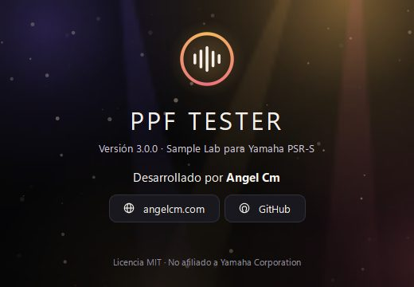

<p align="center">
  
</p>

<h1 align="center">PPF Tester</h1>

<p align="center">
  <b>Sample Lab para Yamaha PSR-S670 · S770 · S775 · S970 · S975</b><br>
  Analiza, escucha, compara y mejora tus packs <code>.ppf</code> de Yamaha Expansion Manager.<br>
  Desarrollado por <a href="https://angelcm.com"><b>Angel Cm</b></a> · <a href="https://angelcm.com">angelcm.com</a>
</p>

<p align="center">
  <a href="https://github.com/angel-cm-dev/ppf-tester/releases/latest"></a>
  <a href="LICENSE"></a>
  
</p>

<p align="center">
  
</p>

## Novedades de la versión 3

- Interfaz nueva en **Qt**: barra lateral, tarjetas, transiciones suaves y tipografía cuidada.
- **Fondo animado estilo worship**: luces de escenario que se mueven y respiran, rayos de luz y partículas
  que **laten con la música** cuando tocas el kit (se puede desactivar en Ajustes).
- Pantalla de bienvenida, **arrastrar y soltar** archivos `.ppf`, archivos recientes y avisos discretos.
- Piano que brilla al sonar, medidores de nivel y barras de memoria por modelo.
- Aviso automático cuando hay una versión nueva en GitHub.

<p align="center">
  
</p>

## Qué hace

| | |
|---|---|
| **Importar WAV** | Arrastra una carpeta con tus golpes de batería y la app arma el `.ppf`: detecta bombo, caja, toms, hi-hat y platos, junta versiones y capas, y lo ajusta a la memoria de tu teclado. Puedes mover piezas al piano arrastrándolas. |
| **Muestras** | Piano con el estado de cada tecla, forma de onda, espectro, medidas (pico, RMS, DC, silencios) y editor por tecla (afinación, volumen, paneo, filtro, grupo de corte). Reemplaza una muestra por un WAV. |
| **Escuchar** | Toca el kit con el ratón o el teclado del PC: *simulación del PSR* (curva de velocidad, filtro, paneo, reverb), *PSR real por MIDI* (sonido exacto, con monitor y grabación) o la *muestra original*. Comparación A/B y ritmos de prueba (balada, worship 6/8, pop, rock, toms, dinámica). |
| **Mejorar kit** | Elige el teclado destino y mejora todo: limpieza, procesado por pieza (bombo, caja, toms, hi-hat, ride, crash), balance, afinación de toms, corte de hi-hat, filtro y capas de velocidad ligeras. Controla la memoria de cada modelo. |
| **Revisión** | Huecos de velocidad, muestras repetidas, estéreo falso, hi-hat sin corte, balance del kit. |
| **Prueba en el teclado** | Toca todas las notas en el PSR por USB-MIDI, graba la salida y detecta notas mudas, retardos y dinámica incorrecta. |

<p align="center">
  
  
</p>
<p align="center">
  
  
</p>

## Memoria de expansión por modelo

| Modelo | Memoria | Recomendado por kit | Capas de velocidad (auto) |
|---|---|---|---|
| PSR-S670 | ≈ 32 MB | ≤ 4 MB | 2 (sin capas en platos) |
| PSR-S770 | 160 MB | ≤ 20 MB | 3 |
| PSR-S775 | 280 MB | ≤ 30 MB | 3 |
| PSR-S970 | 512 MB | ≤ 50 MB | 3 |
| PSR-S975 | 768 MB | ≤ 60 MB | 3 |

## Descarga (recomendado)

1. Ve a **[Releases](https://github.com/angel-cm-dev/ppf-tester/releases/latest)** y descarga **`PPF-Tester.exe`**.
2. Ábrelo. No necesitas instalar Python ni nada más (≈ 52 MB, Windows 10/11).

> Windows SmartScreen puede avisar la primera vez porque el ejecutable no está firmado:
> pulsa **“Más información” → “Ejecutar de todas formas”**.

## Ejecutar desde el código

1. Instala [Python 3.10 o superior](https://www.python.org/downloads/) marcando **“Add Python to PATH”**.
2. Descarga este repositorio y haz doble clic en **`Instalar.bat`** (instala `numpy`, `sounddevice` y `PySide6`).
3. Abre el programa con **`PPF Tester.bat`**.

O desde la consola:

```powershell
pip install -r requirements.txt
python ppf_tester/qt_main.py
```

## Línea de comandos

```powershell
python ppf_tester/ppf_tester.py analizar MI_KIT.ppf --abrir
python ppf_tester/ppf_tester.py importar "C:\Mis WAV\Real Drums" --modelo S670
python ppf_tester/ppf_tester.py mejorar  MI_KIT.ppf --modelo S670
python ppf_tester/ppf_tester.py corregir MI_KIT.ppf --agrupar-hihat
python ppf_tester/ppf_tester.py extraer  MI_KIT.ppf
python ppf_tester/ppf_tester.py puertos
python ppf_tester/ppf_tester.py teclado  MI_KIT.ppf --grabar --entrada 1
```

## Probar en el PSR

1. Conecta el PSR al PC por **USB TO HOST** y la salida de auriculares del PSR a tu interfaz de audio.
2. Instala el pack en el teclado y elige la voz en **RIGHT 1**.
3. En **Prueba en el teclado**, elige la salida MIDI del PSR y la entrada de audio.
4. En **Escuchar**, elige **PSR real por MIDI** y toca, o pulsa **Tocar ritmo**.

> Antes de instalar un pack mejorado en el teclado, ábrelo en **Yamaha Expansion Manager** y escúchalo.
> Recuerda que instalar un archivo de instalación reemplaza toda la memoria de expansión del teclado.

## Publicar una versión nueva (mantenedor)

1. Cambia el número en `ppf_tester/version.py` y anota los cambios en `CHANGELOG.md`.
2. Sube los cambios y crea la etiqueta:

```powershell
git commit -am "Versión 2.1.0"
git tag v2.1.0
git push origin main --tags
```

GitHub Actions compila `PPF-Tester.exe` y lo publica en **Releases** automáticamente.
Para compilarlo en tu PC: `Compilar exe.bat` (resultado en `dist\`).

## Formato .ppf (referencia técnica)

Contenedor `XPFH` con bloques `TAG + longitud (big-endian)` alineados a 4 bytes. Cada recurso es un `BLOB`
con `EUID`, `ETIT`, `EEXT` (`uvf` = voz en XML, `APCp` = onda) y `FBIN`. Las ondas son AIFF tipo `YTWV`
(PCM 16 bits) y su `EUID` es el SHA-1 del contenido; el programa lo recalcula al modificar una muestra.

## Próximas mejoras

Una mejora nueva cada día: mira la [hoja de ruta](ROADMAP.md).

## Licencia

[MIT](LICENSE) © 2026 [Angel Cm](https://angelcm.com). Puedes usarlo, modificarlo y compartirlo manteniendo el aviso de autoría.

---

<p align="center">
  Hecho con ♥ para músicos de alabanza · <a href="https://angelcm.com"><b>Angel Cm</b></a><br>
  <sub>No afiliado a Yamaha Corporation. “Yamaha”, “PSR” y “Expansion Manager” son marcas de sus respectivos dueños.</sub>
</p>
